# MediAI — AI-Powered Online Pharmacy & Smart Medication Management System

MediAI is an integrated, AI-powered digital pharmacy platform that combines a full online pharmacy, an offline-first medicine reminder and stock-management system, prescription scanning via OCR, and a Retrieval-Augmented Generation (RAG) **AI Virtual Pharmacist** — all in one ecosystem.

The platform spans four cooperating pieces:

- **Mobile app** ([lib/](lib/)) — a Flutter customer app: browse/order medicines, scan prescriptions, manage reminders and household stock, and chat with the AI pharmacist.
- **Admin panel** ([MediAdmin/](MediAdmin/)) — a Flutter web dashboard for pharmacists/operators to manage the catalog, orders, customers, promotions, and prescription requests.
- **AI backend** ([backend/](backend/)) — a Python FastAPI service hosting the RAG chatbot, symptom-triage engine, pharmaceutical knowledge index, and the server-authoritative coupon engine.
- **Cloud backend** — Google Firebase (Authentication, Firestore, Storage, Cloud Messaging) for identity, the primary database, media storage, and push notifications.

> Built as a Final Year Project for the BS Computer Science degree at Sir Syed CASE Institute of Technology, Islamabad, by **Ibrahim Farooq** and **Ahmad Forrukh**.

## Key Features

| Area | What it does |
|---|---|
| 🔐 **Authentication** | Email/password, Google, and Facebook sign-in via Firebase Auth, with email verification, password reset, and role-based routing for customers vs. admins. |
| 🛒 **Online Pharmacy** | Category/brand browsing, search, product details with reviews, wishlist, cart, coupon-driven checkout, and order tracking. |
| 📷 **Prescription OCR** | Photograph a handwritten prescription and a vision-language model (Google Gemini) extracts medicine names, dosage frequency, and duration to auto-fill the medication form. |
| ⏰ **Reminders & Alarms** | Offline-first, SQLite-backed medicine reminders that fire full-screen alarms even with no internet, and survive device restarts. |
| 📦 **Stock & Auto-Refill** | Household stock auto-decrements as doses are taken, warns before running out, and auto-replenishes stock when a tracked order is delivered — closing the loop between buying and taking medicine. |
| 🤖 **AI Virtual Pharmacist** | A RAG chatbot grounded in authoritative drug labels (DailyMed, OpenFDA) with RxNorm-based brand/generic name resolution and fuzzy matching for misspelled medicine names. Includes a stateful symptom-triage engine with emergency detection. |
| 🧑‍💼 **Admin Panel** | Real-time dashboard, catalog management, order/customer management, promotional banners, coupon campaigns, prescription-request review, and role-based admin management. |
| 🔄 **Offline-First Sync** | Bidirectional synchronization between local SQLite and Firestore, with an offline operation queue and role-based Firestore security rules. |

## Screenshots

<table>
  <tr>
    <td align="center">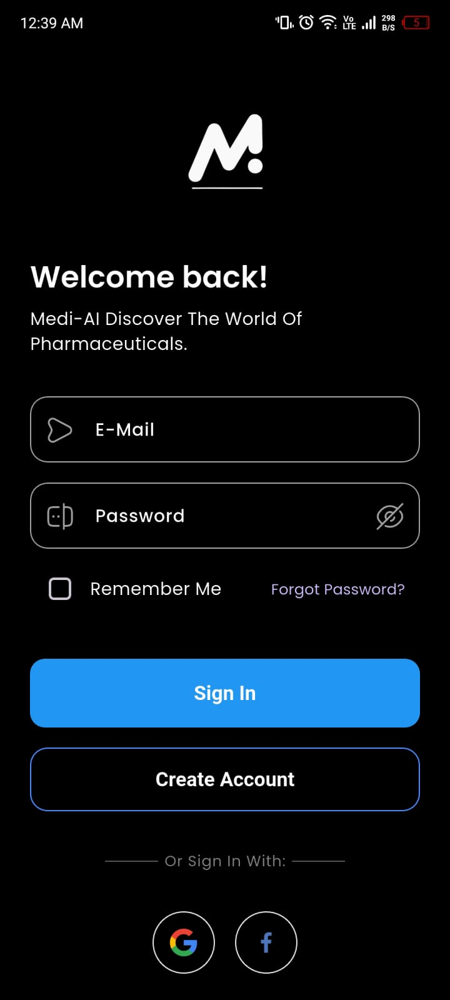<br/>Login</td>
    <td align="center">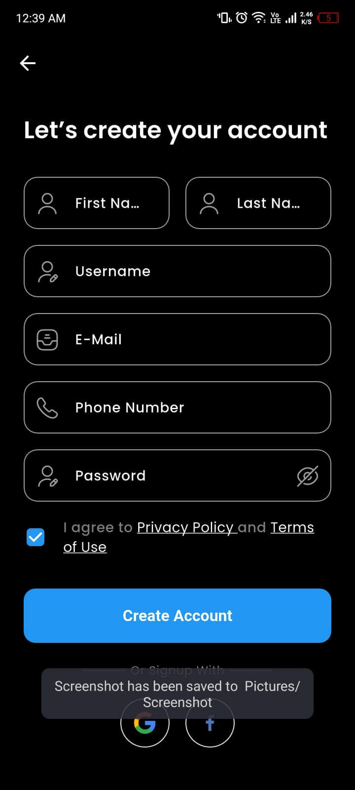<br/>Sign Up</td>
    <td align="center">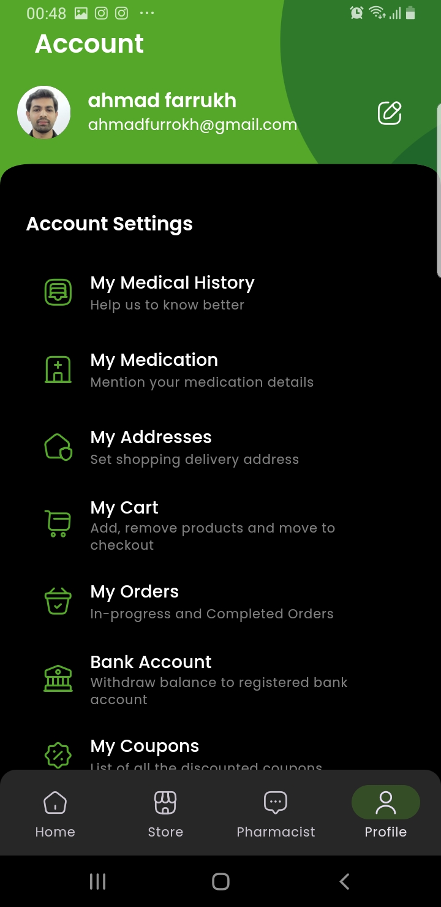<br/>Personalization</td>
    <td align="center">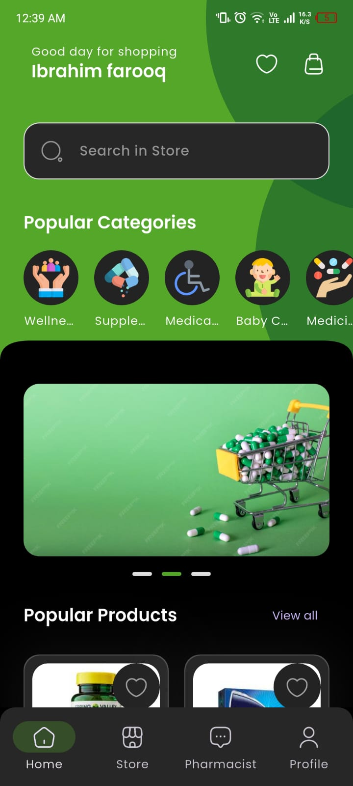<br/>Home</td>
  </tr>
  <tr>
    <td align="center">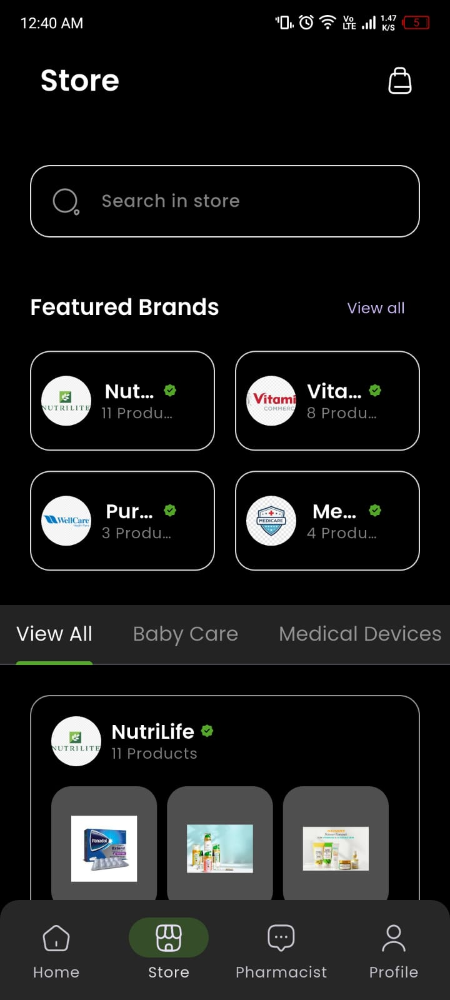<br/>Store</td>
    <td align="center"><br/>Product Details</td>
    <td align="center">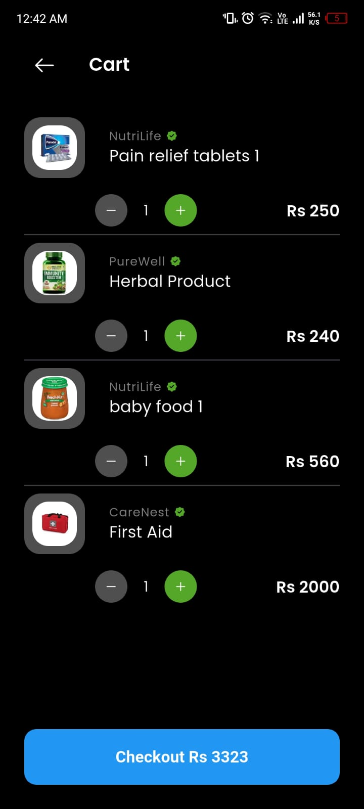<br/>Cart</td>
    <td align="center">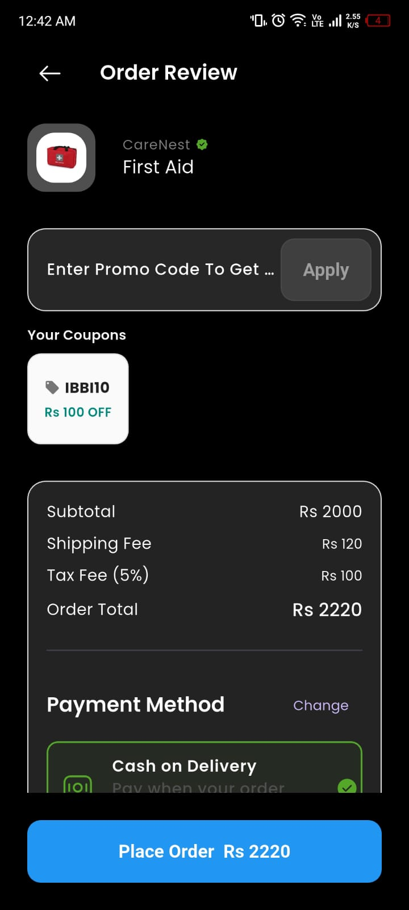<br/>Checkout</td>
  </tr>
  <tr>
    <td align="center"><br/>Prescription OCR Scan</td>
    <td align="center"><br/>Auto-filled Medication Form</td>
    <td align="center">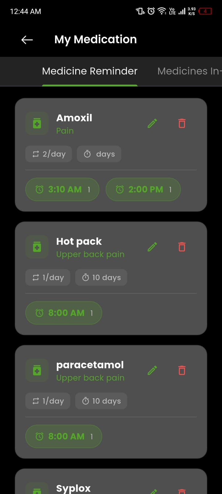<br/>Medication List</td>
    <td align="center"><br/>Full-Screen Alarm</td>
  </tr>
  <tr>
    <td align="center"><br/>Stock Management</td>
    <td align="center"><br/>AI Virtual Pharmacist</td>
    <td align="center"><br/>Symptom Triage</td>
    <td></td>
  </tr>
</table>

## Architecture & Diagrams

<table>
  <tr>
    <td align="center">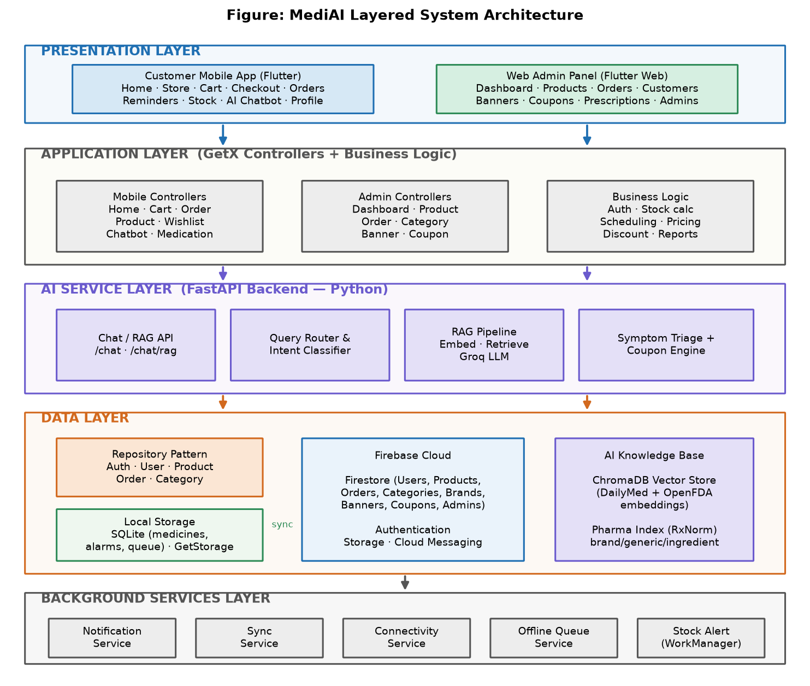<br/>Layered System Architecture</td>
    <td align="center">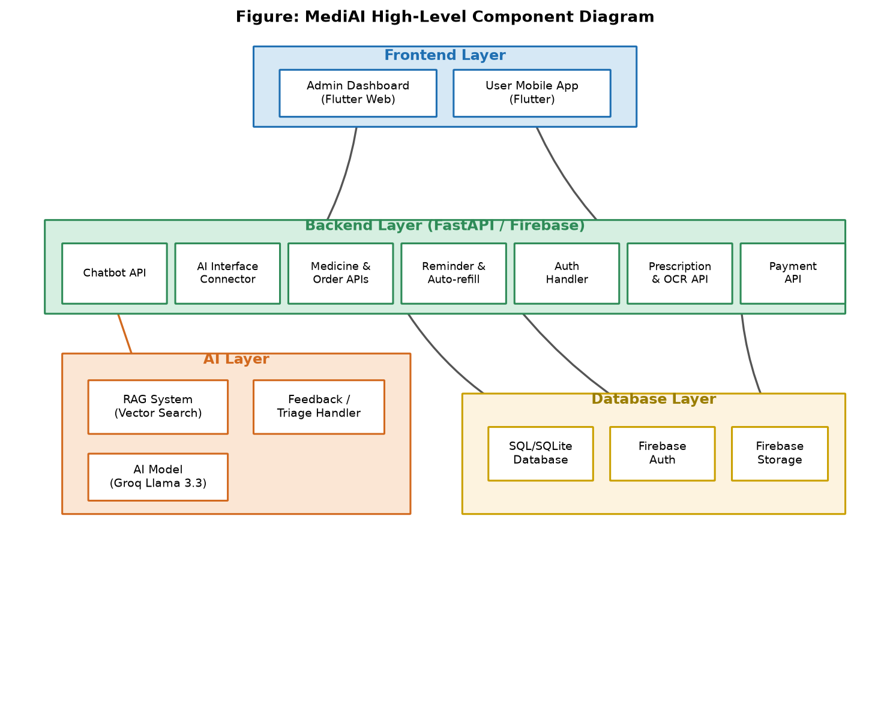<br/>Component & Data-Flow Diagram</td>
  </tr>
  <tr>
    <td align="center">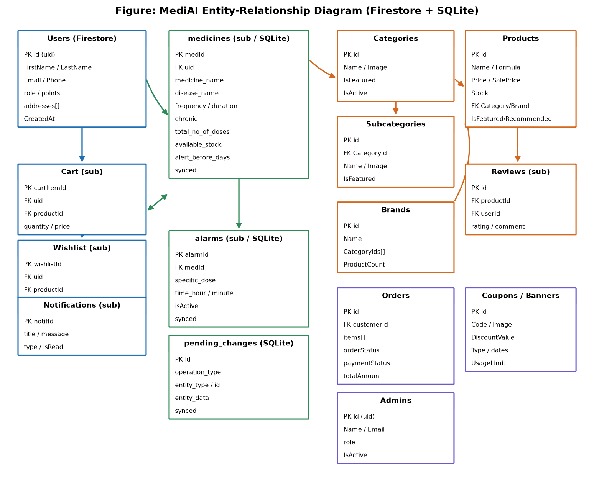<br/>Entity-Relationship Diagram (Firestore &amp; SQLite)</td>
    <td align="center">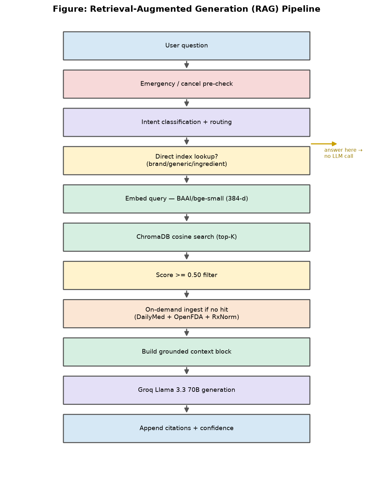<br/>Retrieval-Augmented Generation Pipeline</td>
  </tr>
  <tr>
    <td align="center">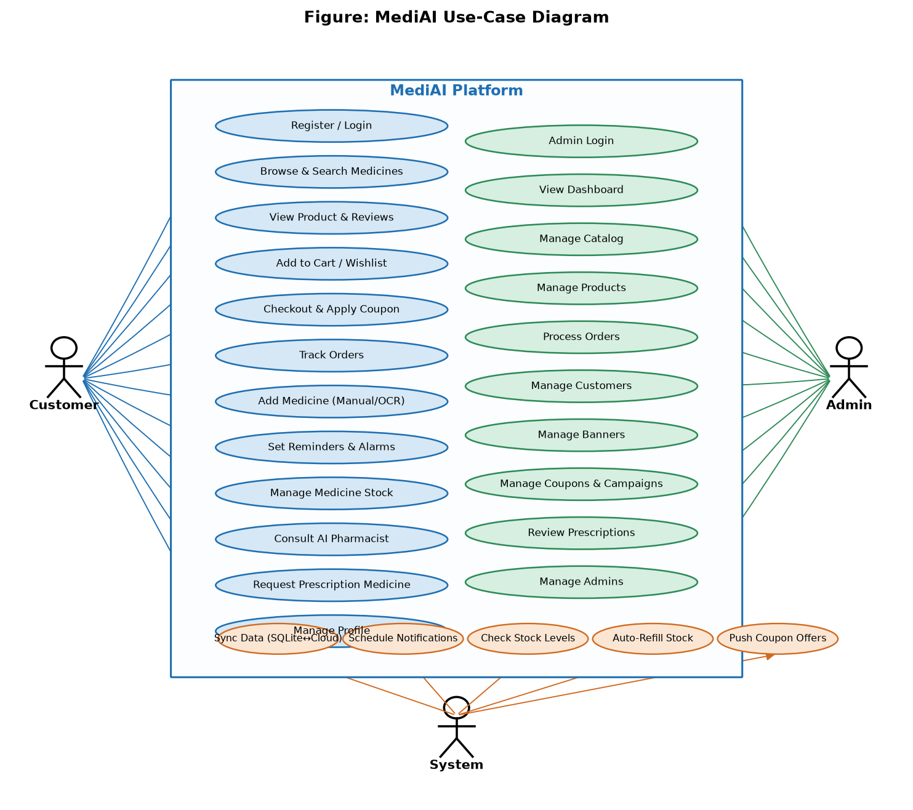<br/>Use-Case Diagram</td>
    <td align="center">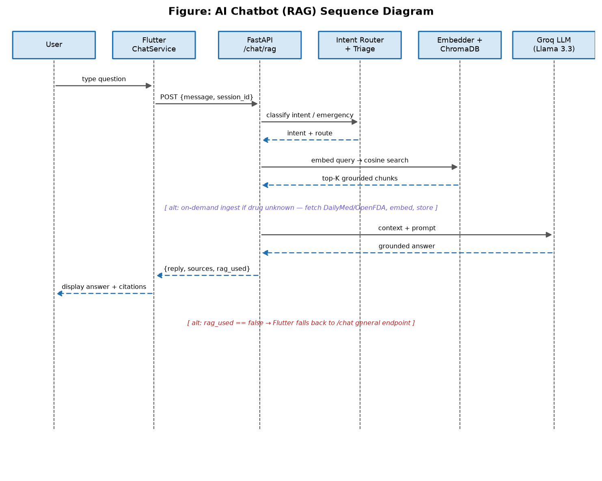<br/>AI Chatbot Sequence Diagram</td>
  </tr>
  <tr>
    <td align="center">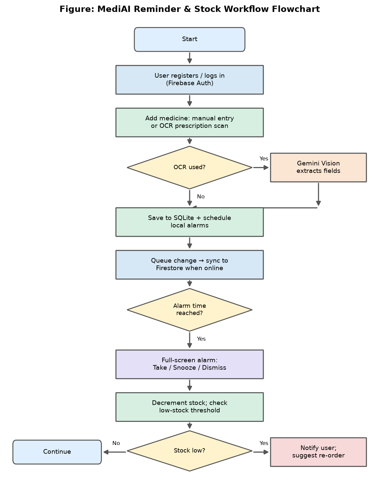<br/>Reminder & Stock-Management Flowchart</td>
    <td align="center">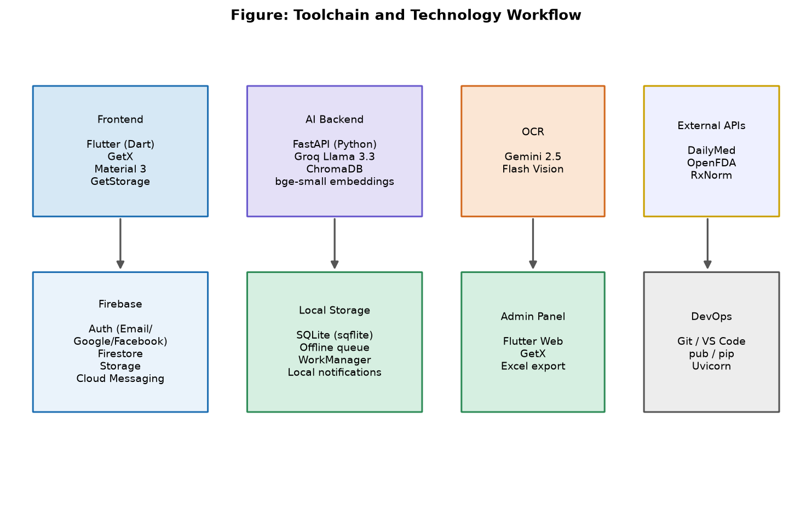<br/>Toolchain & Technology Workflow</td>
  </tr>
</table>

## Tech Stack

- **Client:** Flutter & Dart, GetX (state management, DI, routing)
- **Cloud:** Firebase Authentication, Cloud Firestore, Firebase Storage, Firebase Cloud Messaging
- **Local/offline:** SQLite (reminders, stock, sync queue)
- **AI backend:** Python, FastAPI, Groq (LLM inference, `llama-3.3-70b-versatile`), Sentence-Transformers embeddings, ChromaDB (vector store)
- **Grounding sources:** DailyMed, OpenFDA, RxNorm
- **OCR:** Google Gemini vision model for prescription digitization

## Project Structure

```
MediAI/
├── lib/            # Flutter customer mobile app
├── MediAdmin/       # Flutter web admin panel
├── backend/         # Python FastAPI AI backend (RAG chatbot, triage, coupons)
│   ├── main.py
│   ├── rag/         # Embedding, vector store, ingestion, chat service
│   └── coupon/      # Server-authoritative coupon engine
├── android/ ios/ web/ windows/ linux/ macos/   # Flutter platform targets
├── firestore.rules  # Firestore security rules
└── assets/          # App images, fonts, icons
```

## Getting Started

### Mobile app
```bash
flutter pub get
flutter run
```

### Admin panel
```bash
cd MediAdmin
flutter pub get
flutter run -d chrome
```

### AI backend
```bash
cd backend
python -m venv .venv
.venv\Scripts\activate          # Windows
pip install -r requirements.txt
```
Create a `.env` file in `backend/` with:
```
GROQ_API_KEY=your_groq_api_key
```
Then run:
```bash
uvicorn main:app --reload
```

Both the mobile app and admin panel require a Firebase project configured via `flutterfire configure` (or by dropping in your own `google-services.json` / `firebase_options.dart`).

## Authors

- **Ibrahim Farooq** — 2410-4017
- **Ahmad Forrukh** — 2230-0059

BS Computer Science, Department of Computer Science, Sir Syed CASE Institute of Technology, Islamabad.
